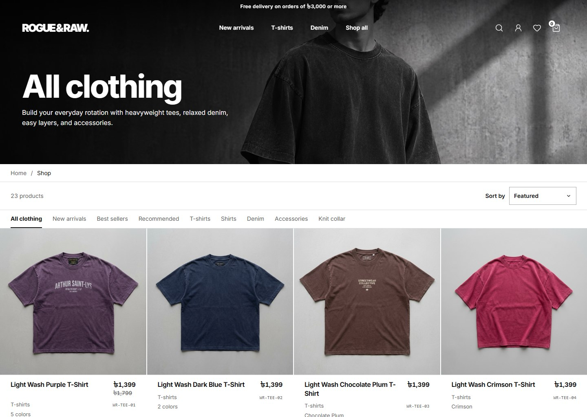
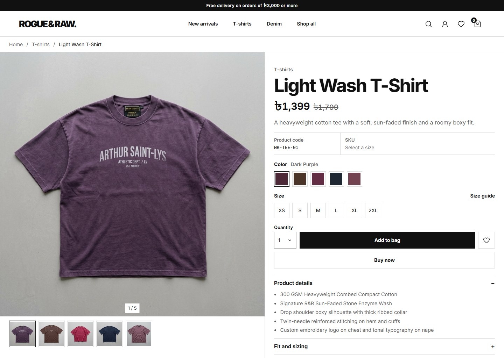
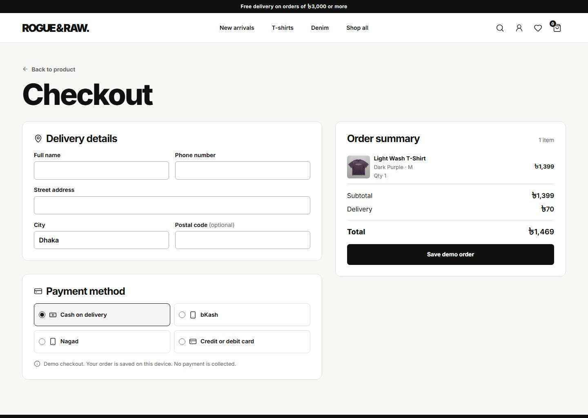

# Rogue & Raw
LIVE LINK:
[Live Demo](https://rakibhjoy.github.io/clothing-brand-ecom/)

Rogue & Raw is a streetwear storefront demo built with React and Vite. You can browse tees, denim, shirts, and accessories, pick a color and size, and go through checkout. Prices are shown in Bangladeshi taka.

## What you can do

- Browse collections, search the catalog, and sort by price or rating.
- Look through product photos, choose a color and size, and share a product link.
- Save items for later or add them to your shopping bag. The bag lets you change quantities, apply a promo code, and see estimated delivery costs.
- Check out from the bag or use **Buy now** on a product page. The demo shows delivery charges for Dhaka and other cities.
- Shop as a guest or create a demo account to save your delivery details and revisit your order history.

## Screenshots

### Storefront


### Catalog



### Product page



### Checkout



## Run it locally

```sh
npm ci
npm run dev
```

Open the local URL Vite prints in your terminal.

```sh
npm run lint
npm run build
npm run preview
```

The production build goes into `dist/`. The preview command serves that build locally.

## Demo data

The shopping bag, saved items, accounts, and orders are stored in your browser. Sign-in works on localhost or HTTPS. If you created an account in an older version of the demo, create it again. Checkout saves a demo order on your device and collects no payment.

## Deploying to GitHub Pages

For `rakibhjoy.github.io/clothing-brand-ecom/`, set the Vite base to `/clothing-brand-ecom/` and use that base for image URLs. Use hash-based routes for pages such as the catalog and checkout so direct links and refreshes work on Pages. Open **Pages** in the repository settings and select **GitHub Actions** as the source and use a workflow that runs `npm ci`, builds the app, and publishes `dist/`. [Vite’s GitHub Pages guide](https://vite.dev/guide/static-deploy.html#github-pages)
